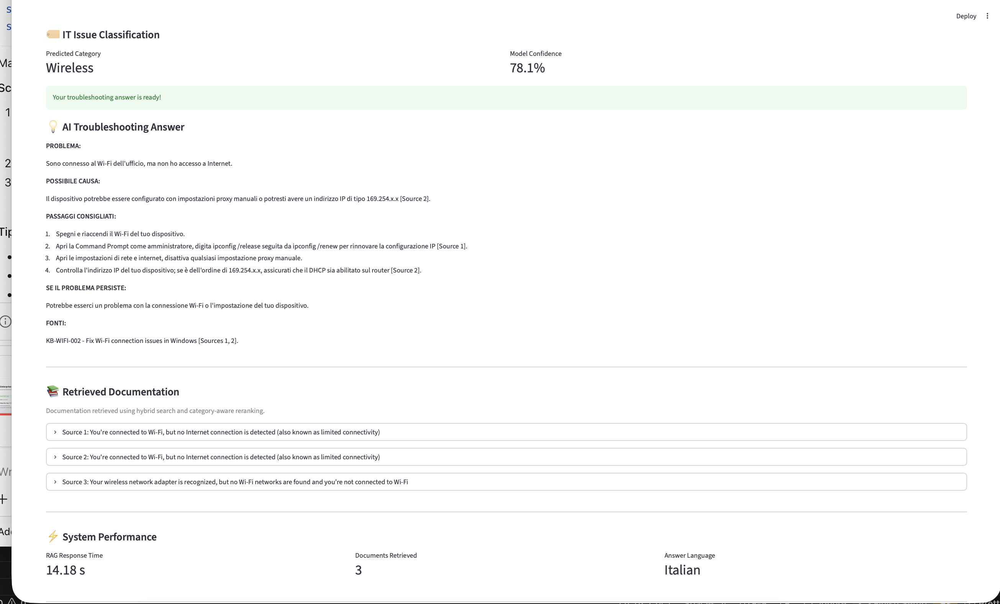
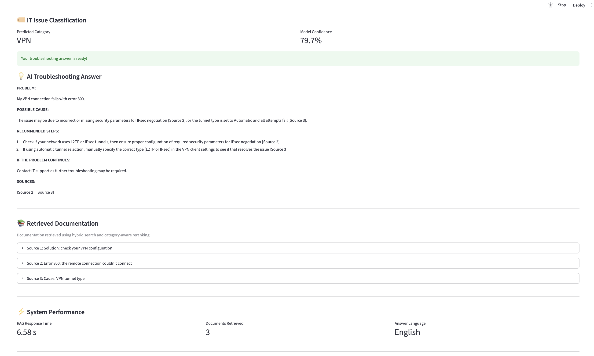
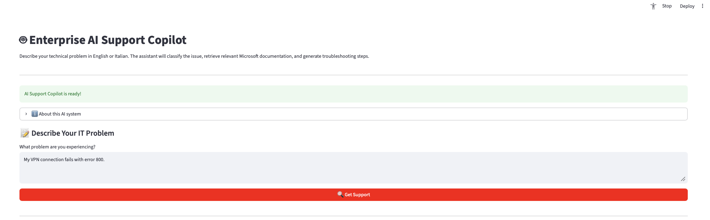

# Multilingual IT Support RAG

A Streamlit app that answers IT support questions in Italian or English, using Microsoft troubleshooting documentation.

## How the app works

1. **The user writes a problem** in Italian or English, for example "My VPN connection fails with error 800."
2. **The classifier predicts the category** (Wireless, VPN, DNS, DHCP, Email, …) and shows how confident it is.
   - If the category is covered by the documentation, the search is limited to those documents.
   - If the category is not covered (for example Keyboard or Monitor), the app says it has no documentation and suggests contacting IT.
   - If the confidence is below 60%, it searches all documents.
3. **Hybrid search finds the 3 most relevant passages**: BM25 keyword search and semantic search (embeddings) are combined with Reciprocal Rank Fusion.
4. **The LLM writes the answer** from those passages only, in the same language as the question, with this structure: problem, possible cause, recommended steps, what to do if the problem continues, and sources.
5. **The app shows the retrieved passages** so the user can check where each step comes from, together with the response time and the answer language.

## Tech stack

| Part | Technology |
|---|---|
| Interface | Streamlit |
| Classifier | XLM-RoBERTa, fine-tuned on the [ticket_classification_IT_EN](https://huggingface.co/datasets/Noise144/ticket_classification_IT_EN) dataset |
| Embeddings | sentence-transformers `paraphrase-multilingual-MiniLM-L12-v2` |
| Vector search | FAISS |
| Keyword search | BM25 |
| LLM | Qwen2.5-7B, running locally with Ollama |
| Documents | Microsoft Learn and Microsoft Support articles (Wi-Fi, VPN, DNS, DHCP, Email, network), parsed with BeautifulSoup |
| Language | Python |

## Screenshots

### Italian question about Wi-Fi

The question is *"Sono connesso al Wi-Fi dell'ufficio ma non ho accesso a internet"* ("I'm connected to the office Wi-Fi but I have no internet access").

- The classifier predicts **Wireless** with 78.1% confidence.
- The answer is in **Italian** and gives four steps: turn Wi-Fi off and on, renew the IP address with `ipconfig`, disable manual proxy settings, and check for a 169.254.x.x address.
- Each step shows the source it comes from, for example [Source 1].
- Under **Retrieved Documentation**, the sources are the sections of Microsoft's "Fix Wi-Fi connection issues in Windows" guide about limited connectivity.

### English question about VPN

The question is *"My VPN connection fails with error 800."*

- The classifier predicts **VPN** with 79.7% confidence.
- The answer explains the two possible causes from the documentation (IPsec security parameters, tunnel type set to Automatic) and how to check them.
- The retrieved sources are the Microsoft sections about error 800, its cause and its solution.
- The answer is in **English** and took 6.6 seconds.

### Home screen

The user types the problem in the text box and clicks **Get Support**.
